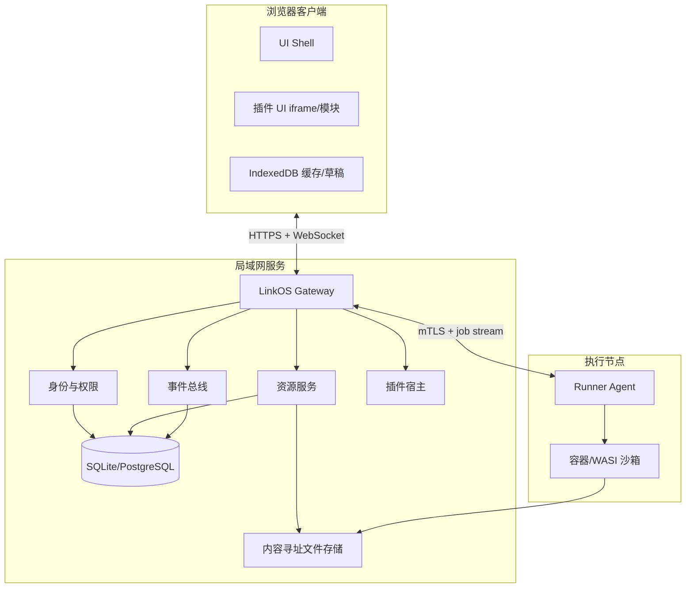

+# LinkOS 局域网办公协同平台

产品需求文档（PRD）与项目落地方案

版本：v1.0

状态：立项评审稿

日期：2026-08-29

## 0. 文档摘要

LinkOS 是一个局域网优先的纯网页办公协同平台，面向研发团队、实验室、工作室和内网办公室，统一提供文件传输、实时聊天、代码查看与编辑、编译运行、任务状态和后续办公插件能力。

产品的核心原则是“一切皆插件，极致性能”：核心只负责身份、权限、事件总线、资源编排和运行时；文件、聊天、代码、终端、任务、通知等都以一等插件实现。客户端不安装桌面应用，用户打开网页即可加入工作区；局域网服务负责数据持久化与安全执行。

本文件同时定义：产品边界、目标用户、核心流程、功能需求、插件规范、系统架构、协议与数据模型、性能与安全指标、分期计划、团队分工、验收标准和风险应对。

## 1. 产品定义

### 1.1 一句话定位

在可信局域网内，把“找人、传文件、聊事情、看代码、跑代码”收敛到一个低延迟、可扩展、可自托管的网页工作台。

### 1.2 产品目标

| 目标 | 结果定义 | 首期指标 |
| --- | --- | ---: |
| 降低协同切换成本 | 文件、聊天、代码和运行结果可在同一工作区关联 | 关键流程最多 3 次页面跳转 |
| 让局域网资源真正可用 | 自动发现工作区、设备和在线成员 | 首次打开 10 秒内完成发现 |
| 保持极致性能 | 首屏和实时交互不被大文件/长日志拖慢 | 首屏可交互 P95 <= 1.5s；消息端到端 P95 <= 150ms |
| 保障内网安全 | 最小权限、可审计、执行环境隔离 | 高危运行能力默认关闭；审计覆盖率 100% |
| 形成插件生态 | 功能可以独立安装、升级、禁用和回滚 | 首期 6 个官方插件；第三方 SDK 可开发 |

### 1.3 非目标

- 不替代公网即时通信、视频会议或企业级 OA 审批系统。
- 不在首期实现跨公网组网、复杂组织绩效、完整 Git 托管或企业级数据仓库。
- 不把任意代码直接运行在网关主进程或浏览器主线程中。
- 不承诺所有语言都能在零安装模式下编译运行；原生工具链必须由 Runner 提供。

### 1.4 术语

| 术语 | 定义 |
| --- | --- |
| 工作区 Workspace | 一个局域网协作边界，包含成员、插件、文件、频道和权限策略 |
| 网关 Gateway | 局域网内的核心服务，负责鉴权、路由、事件、元数据和插件宿主 |
| Runner | 隔离的编译/运行执行节点，可独立部署在网关或其他局域网机器 |
| 插件 Plugin | 通过声明式 manifest 和受限 API 扩展产品能力的模块 |
| 资源 Resource | 文件、代码仓库、频道、任务、运行会话等可授权对象 |
| 事件 Event | 通过事件总线传递的状态变化，支持重放和幂等 |
| 设备 Device | 一个浏览器会话或一个 Runner/网关节点 |

## 2. 用户与场景

### 2.1 目标用户

| 用户 | 主要任务 | 关键痛点 |
| --- | --- | --- |
| 研发成员 | 分享代码、讨论问题、运行验证 | 工具分散；上下文丢失；内网文件传输慢 |
| 技术负责人 | 查看进度、复现问题、管理权限 | 信息不聚合；执行不可审计 |
| 实验室/工作室成员 | 传输大文件、共享设备资源 | 公网网盘受限；发现与权限复杂 |
| 系统管理员 | 部署网关、管控插件和 Runner | 维护成本高；安全边界模糊 |

### 2.2 高频任务（Jobs To Be Done）

1. “我想把一个 2 GB 的构建包发给同事，不经过公网，也不用压缩分卷。”
2. “我想在讨论消息里直接打开代码、标注行号并运行一个复现命令。”
3. “我想看到某次运行使用了什么代码版本、谁发起、输出是什么。”
4. “我想把一个新工具接入工作台，但不希望改动核心代码。”
5. “我想在手机或低配置电脑上查看状态，不被大量日志拖垮。”

### 2.3 首要用户旅程


## 3. 产品原则与设计方向

### 3.1 产品原则

- **局域网优先**：默认发现本地工作区；所有大文件和执行流量优先走内网。
- **核心最小化**：核心只保留不可替代的能力；业务功能均通过插件提供。
- **事件驱动**：状态变化统一进入事件总线，前端按需订阅，不轮询大对象。
- **渐进式增强**：低配置浏览器先获得查看和聊天能力；高级能力按需加载。
- **可观测可回滚**：插件、运行任务、文件传输都具备状态、日志、审计和回滚路径。
- **默认安全**：执行、外链、跨工作区共享、批量下载等高风险能力都需要明确授权。

### 3.2 UI 参考与转译

参考 `jsos.dev` 的体验特征：黑色沉浸背景、蓝色光晕/宇宙视觉、悬浮胶囊控件、系统启动状态和轻量通知。LinkOS 采用以下转译：

| 参考特征 | LinkOS 落地方式 |
| --- | --- |
| 黑色沉浸背景 | 工作台深色底，减少大面积高亮，适合长时间研发工作 |
| 蓝色空间感 | 只用于在线状态、运行中、焦点和品牌信号，不做大面积渐变 |
| 悬浮控件 | 左侧导航、顶部工作区切换、底部命令条使用紧凑胶囊/图标控件 |
| 系统启动提示 | 首次连接显示“发现工作区/校验权限/加载插件”的可解释进度 |
| 流动感 | 面板切换采用 120-180ms 微动效；遵循 `prefers-reduced-motion` |

设计约束：信息密度高于装饰性；不使用卡片套卡片；文件列表、代码编辑器和日志区域采用稳定尺寸；所有图标按钮提供可访问名称和悬浮提示。

### 3.3 信息架构

```text
工作区
├── 总览（插件提供的可配置首页）
├── 文件
│   ├── 最近
│   ├── 共享目录
│   └── 传输队列
├── 聊天
│   ├── 频道
│   ├── 私聊
│   └── 线程
├── 代码
│   ├── 仓库/目录
│   ├── 查看器/编辑器
│   └── 运行会话
├── 任务
├── 插件中心
└── 管理
    ├── 成员与角色
    ├── Runner
    ├── 审计日志
    └── 系统设置
```

## 4. MVP 范围

### 4.1 MVP 必须有

- 局域网工作区发现：mDNS/UDP 广播 + 手动地址兜底。
- 邀请码/一次性二维码入网；管理员审批开关。
- WebSocket 实时连接、断线重连、心跳、事件序号和离线补发。
- 文件上传、下载、断点续传、并发控制、哈希校验、传输队列。
- 频道聊天、线程回复、@成员、消息搜索、消息中引用文件/代码行。
- 代码目录浏览、语法高亮、只读查看、基础编辑、保存版本。
- Runner 注册、任务提交、编译/运行、实时日志、取消、产物下载。
- 插件安装/启用/禁用、权限声明、版本回滚、健康状态。
- 基础 RBAC、审计日志、速率限制、执行超时和资源配额。
- 深色高密度工作台，桌面端优先且可在移动端查看/聊天。

### 4.2 MVP 明确不做

- 多租户 SaaS 计费。
- 公网穿透和跨组织联邦。
- 在线协同编辑的逐字符 CRDT；首期采用乐观锁 + 版本 diff。
- 复杂 Git merge/rebase UI；首期通过插件调用系统 Git。
- 视频/语音会议。
- 任意插件访问宿主文件系统、网络和数据库。

## 5. 功能需求

### 5.1 工作区发现与身份

#### FR-01 工作区发现

- 浏览器访问入口页后，优先通过网关返回的发现接口加载局域网工作区列表。
- 支持 mDNS 服务名 `_linkos._tcp`，同时提供手动输入 `http(s)://host:port`。
- 工作区展示：名称、网段、网关版本、在线人数、TLS 状态、管理员头像或首字母。
- 发现失败时必须给出可执行的手动连接提示，不阻塞本地开发模式。

#### FR-02 入网

- 管理员生成短期邀请码或一次性二维码，默认 10 分钟过期、单次使用。
- 新成员填写显示名；管理员可开启“免审批加入”。
- 支持浏览器端生成设备密钥对，私钥只存储在 IndexedDB/系统凭据容器。
- 登录态采用短期 access token + 可轮换 refresh token；注销时吊销设备会话。

#### FR-03 成员与角色

内置角色：`owner`、`admin`、`member`、`guest`。权限以资源动作表达，例如 `chat.send`、`file.write`、`code.run`、`plugin.install`。所有插件权限必须附着在角色和工作区策略上，不能自行提权。

### 5.2 文件传输插件

#### FR-10 文件资源

- 支持目录、文件、标签、收藏、最近访问和回收站。
- 每个文件保存大小、MIME、内容哈希、创建者、更新时间、版本数和访问策略。
- 大文件采用分片上传，默认分片 8 MiB，可按网络质量动态调整。
- 上传前在浏览器计算分片哈希；服务端完成全量哈希后才能标记为可用。

#### FR-11 传输

- 支持拖拽、文件选择器和粘贴上传。
- 同一客户端默认 3 个并发文件、每文件 4 个分片并发；管理员可设置上限。
- 断线后从最后一个已确认分片恢复，不重复传输已校验块。
- 下载支持 HTTP Range；局域网内启用零拷贝/内核发送能力（实现可选）。
- 展示速度、剩余时间、已完成分片、失败原因和重试按钮。

#### FR-12 共享

- 文件可通过频道消息引用、临时链接或工作区内路径分享。
- 临时链接可设置有效期、下载次数和是否允许转发。
- 默认禁止跨工作区分享；管理员需显式开启并记录审计。

### 5.3 聊天插件

#### FR-20 消息模型

- 支持频道、私聊、线程、系统消息和机器人消息。
- 文本、Markdown 子集、代码块、文件引用、代码行引用和运行结果引用为消息块。
- 消息以客户端生成的 `client_msg_id` 幂等写入，服务端返回 `server_msg_id` 和序号。
- 编辑和删除保留审计版本；删除消息在普通成员视图中隐藏，但审计仍可见。

#### FR-21 实时性

- WebSocket 发送/接收消息；服务端按频道广播。
- 断线重连后客户端携带 `last_event_seq`，服务端补发缺失事件；超过保留窗口则返回快照。
- 心跳间隔 20 秒，连续 2 次无响应标记连接异常。
- 输入状态、在线状态采用短 TTL，不写入持久消息流。

#### FR-22 搜索与关联

- MVP 支持按频道、成员、时间、关键词搜索消息。
- 文件、代码行和运行会话通过资源 ID 关联，点击引用打开对应插件上下文。
- 搜索结果默认返回摘要和高亮片段，不预加载大文件内容。

### 5.4 代码查看与修改插件

#### FR-30 查看

- 支持目录树、面包屑、文件预览、语法高亮、行号、折叠、搜索和大文件分页加载。
- MVP 目标语言：JavaScript/TypeScript、Python、Go、Java、C/C++、Rust、Shell、JSON/YAML/Markdown。
- 文件超过 5 MiB 默认只读并提示大文件模式；单次渲染窗口不超过 2,000 行。

#### FR-31 编辑

- 使用 Monaco Editor 或 CodeMirror 6；编辑器懒加载，首屏不加载语言服务。
- 保存采用 `base_version` 乐观锁；版本冲突时展示三方 diff，用户选择覆盖或另存。
- 自动保存只保存在浏览器本地草稿区；服务端保存需要明确提交。
- 禁止通过编辑器直接执行未经授权的外部命令。

#### FR-32 版本与审阅

- 每次保存生成轻量版本元数据和差异摘要；大文件按内容寻址存储。
- 支持按行生成引用链接：`/code/{resource_id}?line=42`。
- MVP 只提供单人编辑 + 版本对比；多人实时协同编辑列入 P2。

### 5.5 编译运行插件

#### FR-40 Runner 管理

- Runner 启动时向网关注册：节点 ID、平台、工具链、CPU/内存/磁盘容量、版本和标签。
- Runner 通过短期 mTLS 证书或一次性注册令牌接入，证书可吊销和轮换。
- 管理员可暂停、排空、删除 Runner；排空状态不接收新任务。

#### FR-41 任务提交

任务包含：资源快照/提交版本、入口命令、环境变量（默认脱敏）、超时、CPU/内存/磁盘配额、网络策略、输出文件规则和优先级。

- 默认网络策略为无网络；需要联网的插件必须声明域名白名单并经管理员批准。
- 默认最长运行 10 分钟；管理员可按角色和 Runner 标签覆盖。
- 同一成员默认最多 2 个并发任务；工作区总并发可配置。

#### FR-42 执行反馈

- 任务状态：`queued`、`preparing`、`running`、`succeeded`、`failed`、`canceled`、`timed_out`。
- 日志按块推送，客户端虚拟化渲染；支持按级别过滤、复制、下载和跳转。
- 任务可取消；取消分为优雅停止和强制终止两阶段。
- 产物进入文件资源系统，自动带任务 ID、提交版本和生成时间元数据。

#### FR-43 安全执行边界

- 不允许任务直接访问网关数据库、宿主机根目录或其他任务目录。
- 每个任务独立临时目录、非 root 用户、只读基础镜像、seccomp/AppArmor（Linux）或等效隔离。
- 必须清理进程、挂载、临时文件、网络命名空间和凭据。
- 任务输出和命令行参数进行敏感信息扫描，命中规则时只记录脱敏版本。

### 5.6 插件中心

#### FR-50 插件类型

| 类型 | 运行位置 | 适合能力 |
| --- | --- | --- |
| UI 插件 | 浏览器 iframe/沙箱模块 | 文件、聊天、代码、任务面板 |
| 服务插件 | 网关 worker 进程 | 索引、通知、业务逻辑、Webhook |
| Runner 插件 | Runner 沙箱 | 编译器、转换器、测试工具 |
| 组合插件 | 以上组合 | 文档、白板、资产管理 |

#### FR-51 生命周期

插件状态：`discovered` -> `installed` -> `enabled` -> `disabled` -> `uninstalled`。升级必须支持健康检查失败自动回滚上一版本。

- 插件包必须签名，manifest 声明版本、入口、权限、资源、兼容的核心 API 版本。
- 安装前展示权限 diff、数据访问范围和网络域名。
- 禁用插件不删除数据；卸载前提示影响的资源和迁移策略。
- 插件崩溃不得拖垮核心；UI 插件崩溃时显示独立错误边界。

#### FR-52 官方首期插件

1. `workspace.home`：总览和快捷操作。
2. `files.core`：文件资源和传输队列。
3. `chat.core`：频道/私聊/线程。
4. `code.workbench`：代码树、查看、编辑。
5. `runner.exec`：Runner、任务、日志、产物。
6. `admin.control`：成员、策略、审计、插件管理。

## 6. 关键交互与页面规格

### 6.1 工作台布局

```text
┌─────────────────────────────────────────────────────────────┐
│ 工作区选择  在线 12  │ 全局搜索                │ 设备/设置   │
├─────────────┬───────────────────────────────┬───────────────┤
│ 插件导航    │ 当前插件主区                   │ 上下文面板    │
│             │                               │               │
│ 总览        │ 文件/消息/代码/任务的工作面板  │ 成员、线程、   │
│ 文件        │                               │ 运行详情、     │
│ 聊天        │                               │ 资源预览       │
│ 代码        │                               │               │
│ 任务        │                               │               │
│ 插件        │                               │               │
├─────────────┴───────────────────────────────┴───────────────┤
│ 命令条：/ 搜索、打开、运行、发送；连接状态、任务状态、通知   │
└─────────────────────────────────────────────────────────────┘
```

### 6.2 核心状态

每个插件必须实现：

- 空状态：说明下一步动作，提供快捷入口。
- 加载状态：骨架屏或局部 spinner，不阻塞其他面板。
- 已加载状态：内容、筛选、排序、快捷操作。
- 离线状态：保留最近快照，标记不可执行的动作。
- 权限不足：说明所需权限和申请入口，不暴露敏感资源。
- 错误状态：错误码、可重试动作、诊断 ID。
- 高风险确认：命令、文件范围、网络范围和预计影响必须可见。

### 6.3 快捷键

| 快捷键 | 动作 |
| --- | --- |
| `/` | 聚焦命令条 |
| `Ctrl/Cmd + K` | 全局搜索与跳转 |
| `Ctrl/Cmd + P` | 打开资源 |
| `Ctrl/Cmd + Enter` | 在代码面板提交运行任务（需权限） |
| `Ctrl/Cmd + S` | 保存当前草稿 |
| `Esc` | 关闭弹层/取消当前命令 |

## 7. 插件架构

### 7.1 架构原则

- 核心提供稳定的 `Auth`、`Resource`、`EventBus`、`Storage`、`Job`、`UI Shell` API。
- 插件通过 capability 申请能力，不能直接访问内部数据库表。
- 插件间通过资源引用和事件通信，不通过私有函数互调。
- API 按主版本兼容；破坏性变化通过迁移版本和兼容窗口处理。

### 7.2 插件 manifest 示例

```json
{
  "id": "code.workbench",
  "name": "代码工作台",
  "version": "1.0.0",
  "apiVersion": "1.0",
  "entry": {
    "ui": "ui/index.js",
    "service": "service/index.js"
  },
  "contributes": {
    "routes": ["/code", "/code/:resourceId"],
    "commands": ["code.open", "code.save", "code.run"],
    "resourceTypes": ["code.project", "code.file"],
    "messageBlocks": ["code.reference", "run.result"]
  },
  "permissions": [
    "resource.read:code.*",
    "resource.write:code.file",
    "job.submit",
    "event.subscribe:workspace.*"
  ],
  "network": {"mode": "deny"},
  "runner": {"required": true}
}
```

### 7.3 插件 SDK 最小接口

```ts
export interface LinkOSPluginContext {
  auth: {
    currentUser(): Promise<User>;
    check(permission: string, resource?: ResourceRef): Promise<boolean>;
  };
  resources: {
    get(ref: ResourceRef): Promise<Resource>;
    list(query: ResourceQuery): AsyncIterable<Resource>;
    put(input: PutResourceInput): Promise<ResourceVersion>;
  };
  events: {
    publish(event: DomainEvent): Promise<void>;
    subscribe(filter: EventFilter, handler: EventHandler): Disposable;
  };
  jobs: {
    submit(input: JobSpec): Promise<JobRef>;
    cancel(jobId: string): Promise<void>;
  };
  ui: {
    registerCommand(command: Command): Disposable;
    registerPanel(panel: Panel): Disposable;
    notify(notification: Notification): void;
  };
}
```

### 7.4 插件隔离

- UI 插件默认 iframe + `postMessage` RPC，采用 CSP、sandbox、来源校验和消息大小限制。
- 服务插件运行在独立 worker 进程，按插件分配 CPU/内存和事件吞吐配额。
- Runner 插件运行在执行沙箱，不能继承宿主环境变量。
- 插件 API 返回结构化错误，不把堆栈或内部路径直接暴露给普通用户。

## 8. 技术架构

### 8.1 推荐技术栈

| 层 | 推荐 | 选择理由 |
| --- | --- | --- |
| Web 前端 | React + TypeScript + Vite | 生态成熟、代码编辑器和插件 UI 易集成 |
| UI/交互 | CSS Modules 或 Tailwind + Radix/Headless primitives | 可控样式、键盘和无障碍支持 |
| 代码编辑器 | Monaco Editor（桌面）+ CodeMirror 6（轻量/移动） | 语言支持与性能可按设备分层 |
| 实时通道 | WebSocket，二进制帧可选 MessagePack | 低延迟、双向事件和日志流 |
| 网关 | Go（Fiber/Chi + nhooyr/websocket） | 静态部署、并发、内存占用和局域网部署友好 |
| 插件运行时 | Go worker + WASI/Wasmtime（可选） | 插件隔离与跨平台执行 |
| 元数据 | SQLite（单机）/ PostgreSQL（多人规模） | MVP 简单，后续可平滑升级 |
| 对象存储 | 本地内容寻址目录；可选 MinIO/S3 | 支持大文件和快照去重 |
| 搜索 | SQLite FTS5；规模扩大后 Meilisearch/OpenSearch | 先低依赖，后按量扩展 |
| 任务队列 | 网关内存队列 + SQLite 状态；高负载可 NATS JetStream | MVP 简化，保留扩展点 |
| 可观测性 | OpenTelemetry + Prometheus + structured logs | 统一追踪实时链路和 Runner 任务 |
| 部署 | 单一二进制 + `docker compose`；后续 Kubernetes | 适合局域网管理员和离线环境 |

### 8.2 逻辑架构



### 8.3 数据流选择

- 小消息、控制面和状态：JSON over WebSocket。
- 大文件：HTTPS 分片上传/下载；控制事件只传输任务 ID 和分片状态。
- 日志：WebSocket 二进制/文本块，单块建议 16-64 KiB，服务端按字节预算背压。
- 断线补偿：事件序号 + 快照；大对象永不塞入事件总线。

## 9. 核心协议

### 9.1 WebSocket 事件封装

```json
{
  "v": 1,
  "type": "chat.message.created",
  "eventId": "evt_01J...",
  "seq": 18421,
  "ts": "2026-08-29T10:12:33.120Z",
  "workspaceId": "ws_demo",
  "actorId": "usr_123",
  "resource": {"type": "chat.channel", "id": "ch_general"},
  "payload": {"messageId": "msg_456", "clientMsgId": "cm_789"}
}
```

要求：事件 ID 全局唯一；`seq` 在工作区内单调递增；消费者按 `eventId` 幂等；未知事件类型必须忽略并记录指标；大于限制的 payload 改为资源引用。

### 9.2 HTTP API 分组

```text
GET    /api/v1/discovery
POST   /api/v1/sessions
GET    /api/v1/workspaces/:id/snapshot
GET    /api/v1/resources?type=&cursor=
POST   /api/v1/uploads
PATCH  /api/v1/uploads/:id/parts/:partNo
POST   /api/v1/uploads/:id/complete
GET    /api/v1/downloads/:resourceId
POST   /api/v1/jobs
POST   /api/v1/jobs/:id/cancel
GET    /api/v1/jobs/:id/logs?cursor=
GET    /api/v1/plugins
POST   /api/v1/plugins/:id/install
POST   /api/v1/plugins/:id/rollback
GET    /api/v1/audit?cursor=
WS     /api/v1/ws
```

### 9.3 错误码

```text
AUTH_REQUIRED       未认证或会话已过期
FORBIDDEN           权限不足
RESOURCE_VERSION_MISMATCH 乐观锁冲突
UPLOAD_PART_INVALID 分片校验失败
QUOTA_EXCEEDED      配额不足
JOB_POLICY_DENIED   执行策略拒绝
RUNNER_UNAVAILABLE  无可用 Runner
PLUGIN_INCOMPATIBLE 插件与核心 API 不兼容
RATE_LIMITED        请求过频
```

## 10. 数据模型

### 10.1 关键实体

```text
workspace(id, name, policy_json, created_at)
user(id, display_name, status, created_at)
membership(workspace_id, user_id, role, permissions_json)
device(id, user_id, public_key, last_seen_at, revoked_at)
resource(id, workspace_id, type, name, parent_id, owner_id, acl_json)
resource_version(id, resource_id, content_hash, size, created_by, created_at)
message(id, channel_id, author_id, body_json, created_at, edited_at, deleted_at)
event(id, workspace_id, seq, type, payload_json, created_at)
runner(id, workspace_id, labels_json, capabilities_json, status, last_seen_at)
job(id, workspace_id, runner_id, submitter_id, spec_json, status, started_at, ended_at)
job_log(job_id, seq, level, chunk, created_at)
plugin(id, version, manifest_json, status, installed_at)
audit_log(id, workspace_id, actor_id, action, resource_ref, result, metadata_json, created_at)
```

### 10.2 存储策略

- 内容寻址：`sha256/<first2>/<next2>/<full_hash>`，文件版本只保存元数据和 hash。
- 小对象（默认 <= 1 MiB）可存数据库；大对象只存文件系统/对象存储。
- 事件保留 7 天或 1,000,000 条（取先到者）；快照用于超窗口恢复。
- 日志保留按工作区策略，默认 14 天；审计日志默认 180 天且不可由普通管理员删除。

## 11. 性能设计

### 11.1 预算

| 场景 | 目标 |
| --- | ---: |
| 首屏 HTML 到可交互（桌面局域网） | P75 <= 800ms，P95 <= 1.5s |
| 工作区发现 | P95 <= 2s |
| WebSocket 建连到订阅完成 | P95 <= 500ms |
| 消息发送到同网段成员可见 | P95 <= 150ms |
| 10 MiB 文件分片确认 | P95 <= 500ms |
| 1 GB 文件续传恢复 | P95 <= 3s 开始传输 |
| 代码文件首次打开（<= 1 MiB） | P95 <= 700ms |
| 任务状态变更可见 | P95 <= 300ms |
| 网关空载内存 | <= 150 MiB |
| 100 个在线连接内存增量 | <= 100 MiB |

### 11.2 前端策略

- Shell、路由和首屏插件最小化；其余插件按路由和意图懒加载。
- 列表和日志采用窗口化渲染；消息正文和代码 token 采用增量解析。
- 只缓存摘要、最近资源和可恢复上传状态；避免把整个目录树放进 Redux。
- WebSocket 事件按频道/资源过滤，客户端合并短时间内的重复状态更新。
- 大文件、日志和图片使用流式读取，禁止一次性转成 Base64。
- 采用 Web Worker 处理哈希、语法解析和压缩；主线程长任务预算 < 50ms。

### 11.3 网关策略

- 连接管理使用有界队列和背压；慢客户端超过预算后降级为快照通知。
- 事件写入与广播解耦；广播失败不回滚已持久化的业务写入。
- 资源分页使用 cursor，不使用深分页 offset。
- 文件服务支持 Range、sendfile、校验缓存和限速。
- 任务日志只保存摘要和最近窗口，完整日志按分段文件追加。

## 12. 安全与合规

### 12.1 威胁模型

假设局域网并非完全可信，可能存在误入网设备、恶意成员、被上传的恶意文件和恶意代码。安全边界必须覆盖浏览器、网关、Runner、插件和存储。

### 12.2 控制措施

- TLS 默认开启；无证书环境仅允许开发模式并显式提示风险。
- 成员入网采用邀请码/二维码 + 设备公钥；管理员可撤销设备。
- 每次资源操作进行 RBAC/ACL 双重校验；服务端不信任前端隐藏按钮。
- 文件上传限制扩展名只是体验层，安全判断基于 MIME、大小、内容扫描和策略。
- 下载响应设置 `Content-Disposition`、`X-Content-Type-Options`、CSP，避免 HTML/SVG 直接执行。
- WebSocket 限制帧大小、订阅数量、发送频率和消息长度。
- Runner 任务默认无网络、无特权、临时目录隔离、超时和配额强制执行。
- 命令、环境变量、文件路径、插件权限和策略变更写入审计日志。
- 秘密不进入任务日志；支持日志脱敏规则和密钥注入的短期 token。
- 依赖和插件包执行 SBOM、签名校验和漏洞扫描。

### 12.3 高危操作确认

运行任务、启用网络、覆盖冲突版本、跨工作区分享、删除资源和安装插件需要显示：操作者、目标资源、命令/范围、网络策略、配额和可撤销性。

## 13. 可观测性与运维

### 13.1 指标

```text
linkos_ws_connections
linkos_ws_reconnect_total
linkos_event_lag_ms
linkos_event_dropped_total
linkos_upload_bytes_total
linkos_upload_resume_total
linkos_job_queue_depth
linkos_job_duration_ms
linkos_runner_heartbeat_age_seconds
linkos_plugin_crash_total
linkos_api_request_duration_ms
linkos_audit_write_failures_total
```

### 13.2 日志与追踪

- 每个请求、WebSocket 会话、文件传输和 Job 使用 `trace_id`。
- 结构化日志字段至少包含时间、级别、模块、工作区、用户、资源、结果和耗时。
- UI 错误上报错误码、插件版本和浏览器信息，不上传文件内容和消息正文。
- 管理员诊断包默认脱敏；导出前需确认包含范围。

### 13.3 备份与恢复

- 元数据每日快照，关键工作区可配置每小时快照。
- 文件对象按内容 hash 校验；备份任务验证对象完整性。
- 提供 `linkos doctor`：端口、证书、存储、数据库、Runner、插件健康检查。
- 恢复目标：RPO <= 24h（默认），RTO <= 30min（单机）；企业部署由管理员提升。

## 14. 部署方案

### 14.1 单机模式（MVP 默认）

```text
一台局域网主机
├── linkos-gateway
├── data/meta.db
├── data/objects/
├── plugins/
└── runners/（可选：本机 Runner）
```

- 提供 Windows、Linux、macOS 安装包和 Docker Compose。
- 网关提供静态前端和 API，默认监听局域网网卡；管理端可绑定单一网卡。
- 初始化向导生成工作区、管理员、证书和数据目录。

### 14.2 多节点模式（P1）

- 网关无状态化，元数据使用 PostgreSQL，文件使用 MinIO/NFS。
- Runner 作为独立节点横向扩展，通过标签选择工具链。
- 事件总线切换到 NATS JetStream；前端仍使用同一 WebSocket 协议。

### 14.3 离线升级

- 插件和核心包支持离线导入；升级前自动备份元数据和 manifest。
- 版本清单记录核心 API、数据库迁移和插件兼容矩阵。
- 升级失败自动回滚到上一可启动版本；数据迁移采用前向兼容策略。

## 15. 项目仓库建议

```text
linkos/
├── apps/
│   ├── web/                 # React UI Shell + 官方插件 UI
│   └── docs/                # SDK 文档与接口示例
├── services/
│   ├── gateway/             # Go API、WebSocket、鉴权、事件
│   ├── plugin-host/         # 插件生命周期与 worker 管理
│   └── runner/              # Runner Agent
├── packages/
│   ├── protocol/            # 事件、API、错误码、schema
│   ├── plugin-sdk/          # TS/Go SDK
│   ├── ui-kit/              # 设计 token、可访问组件
│   └── testkit/             # 合约测试、fixtures、压测工具
├── plugins/
│   ├── files/
│   ├── chat/
│   ├── code/
│   ├── runner/
│   └── admin/
├── deploy/
│   ├── docker-compose.yml
│   ├── systemd/
│   └── windows/
└── docs/
    ├── prd/
    ├── adr/
    ├── threat-model/
    └── runbooks/
```

## 16. 研发实施计划

### Phase 0：技术验证（2 周）

目标：验证最不可逆的技术风险。

- WebSocket 事件序号、断线补发和快照恢复。
- 1 GB 文件分片上传、断点续传和哈希校验。
- 一个 Go Runner 完成 Node/Python/Go 示例任务隔离执行。
- iframe 插件加载、权限声明和崩溃隔离。
- 在 Windows/Linux 各跑通单机部署。

退出条件：四项 P95 性能达到预算的 80% 以内；安全评审通过基本威胁模型。

### Phase 1：MVP（6-8 周）

| 周期 | 交付 |
| --- | --- |
| 第 1-2 周 | 网关骨架、身份、工作区发现、事件协议、UI Shell |
| 第 3-4 周 | 文件插件、聊天插件、IndexedDB 缓存和断线恢复 |
| 第 5-6 周 | 代码查看/编辑、版本冲突、Runner 注册和任务 API |
| 第 7 周 | 日志流、产物、插件中心、RBAC、审计 |
| 第 8 周 | 压测、安全测试、安装包、文档、试点验收 |

### Phase 2：团队试点（4 周）

- 选择 2-3 个真实团队，20-50 名用户，1-3 台 Runner。
- 采集首屏、重连、传输成功率、任务失败率和活跃路径。
- 修复权限误配、断线、冲突保存、大文件和插件升级问题。

### Phase 3：扩展（持续）

- P1：Git 插件、通知中心、文档/Markdown、任务看板、移动端查看。
- P2：CRDT 实时协同编辑、白板、设备资产、Webhook/机器人、跨节点调度。
- P3：多租户、联邦工作区、企业 SSO、策略即代码和插件市场。

## 17. 团队与协作方式

### 17.1 最小团队

| 角色 | 人数 | 负责范围 |
| --- | ---: | --- |
| 产品/架构负责人 | 1 | 范围、协议、ADR、验收和风险决策 |
| 前端工程师 | 2 | Shell、插件 UI、编辑器、性能与无障碍 |
| Go 后端工程师 | 2 | Gateway、事件、资源、鉴权、存储 |
| 执行与安全工程师 | 1 | Runner、容器/WASI、威胁模型、审计 |
| QA/DevOps | 1 | 自动化测试、压测、安装包、监控和发布 |

### 17.2 工程约束

- 所有跨模块协议先更新 `packages/protocol` 的 schema，再写实现。
- 每个插件拥有独立单元测试、契约测试、权限测试和错误边界测试。
- 合并请求必须附性能影响说明；新增轮询、全量渲染或无界队列需要架构评审。
- 高风险执行能力必须有 threat model、负面测试和审计验证。

## 18. 测试与验收

### 18.1 自动化测试分层

1. 单元测试：权限、分片校验、事件幂等、状态机、manifest 校验。
2. 契约测试：WebSocket/HTTP schema、插件 SDK、Runner 协议。
3. 集成测试：上传-引用-下载、消息-代码行引用、代码-任务-产物。
4. 故障测试：网关重启、网络抖动、Runner 掉线、重复事件、慢客户端。
5. 安全测试：越权、路径穿越、XSS、命令注入、容器逃逸基线、敏感日志。
6. 性能测试：100/500/1,000 连接，10/100 GB 文件，100 个并行 Job。

### 18.2 MVP 验收清单

- 新设备在同一局域网打开页面，2 秒内发现工作区并可加入。
- 发送 1 GB 文件，网络中断后恢复，最终 hash 与源一致且无重复对象。
- 频道消息在 150ms P95 内送达；断线 30 秒后可补齐消息且不重复。
- 打开 1 MiB 代码文件，搜索、编辑、保存和冲突提示可用。
- 任务可提交、实时查看日志、取消、超时，产物可下载并带元数据。
- 普通成员无法安装插件、启用网络或运行超配额任务。
- 禁用/升级插件不影响其他插件；升级失败可回滚。
- 网关重启后数据、权限、消息和任务终态可恢复。
- 键盘可完成主要流程；深色主题对比度和焦点状态符合 WCAG 2.2 AA 基线。
- 生成诊断包不包含消息正文、文件内容、token 和私钥。

### 18.3 发布门禁

```text
必须通过：单元/契约/集成测试、SAST、依赖扫描、权限回归、核心 P95 性能
必须具备：迁移脚本、回滚脚本、变更日志、升级说明、运行手册
必须审批：执行沙箱、网络白名单、插件签名密钥、跨工作区分享
禁止发布：未审计的任意命令执行、无界日志队列、默认明文传输
```

## 19. 风险与决策

| 风险 | 影响 | 应对 | 决策人 |
| --- | --- | --- | --- |
| “纯网页”与原生编译冲突 | 高 | 浏览器只做控制面；Runner 做执行面；WASI 覆盖轻量语言 | 架构负责人 |
| 局域网并不可信 | 高 | TLS、设备密钥、RBAC、审计、Runner 隔离默认开启 | 安全负责人 |
| 插件失控拖垮核心 | 高 | 进程/iframe 隔离、配额、健康检查、回滚 | 架构负责人 |
| 大文件占满内存/带宽 | 中 | 分片、流式、背压、限速、内容寻址去重 | 后端负责人 |
| 浏览器兼容性差异 | 中 | Chromium 优先，Safari/Firefox 设能力降级矩阵 | 前端负责人 |
| 在线协同编辑复杂度 | 中 | MVP 采用版本锁和 diff，CRDT 延后 | 产品负责人 |
| 离线升级失败 | 中 | 自动备份、迁移前检查、双版本启动和回滚 | 运维负责人 |

### 19.1 需要尽早锁定的 ADR

- ADR-001：WebSocket 事件序号、补发窗口和快照协议。
- ADR-002：插件 UI iframe 与模块化加载的边界。
- ADR-003：Runner 隔离技术：容器、WASI 和平台差异。
- ADR-004：内容寻址存储与文件版本生命周期。
- ADR-005：SQLite 到 PostgreSQL/NATS 的迁移边界。
- ADR-006：设备身份、证书轮换和邀请码安全模型。

## 20. 首次迭代的 Definition of Done

一个功能只有同时满足以下条件才算完成：

- 用户路径可从空状态走到成功、失败和重试状态。
- 服务端做权限校验，前端不承担安全责任。
- 事件和 API 有 schema、版本和幂等策略。
- 关键路径有日志、指标、trace_id 和审计记录。
- 至少有一个故障测试和一个越权测试。
- 在低带宽、断线、慢客户端下不会无限占用内存或队列。
- 文档包含配置项、迁移、回滚、故障排查和已知限制。

## 21. 结论与推荐启动方式

推荐以“文件 + 聊天 + 代码只读 + Runner 示例”作为技术验证闭环，再扩展编辑、插件中心和管理控制。这个闭环能在最短时间验证用户价值，同时覆盖平台最关键的四条底层能力：局域网发现、实时事件、大文件流式传输和安全执行。

第一天应建立的不是大量页面，而是以下稳定契约：`Resource`、`DomainEvent`、`PluginManifest`、`JobSpec` 和 `AuditLog`。一旦这些契约稳定，文件、聊天、代码和后续办公能力都能以插件方式并行演进，核心保持小而快。


